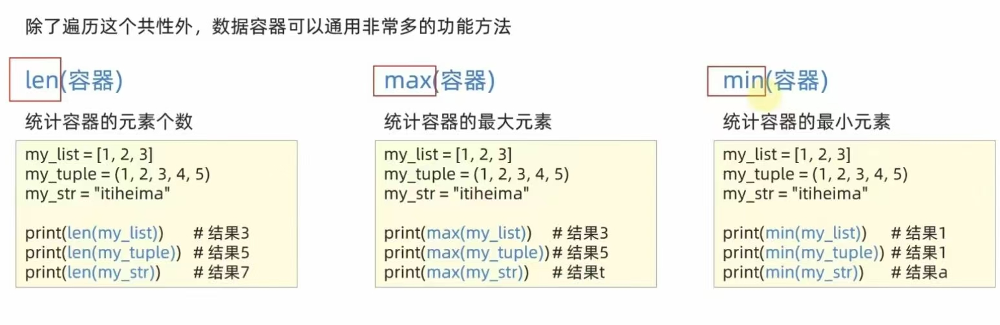
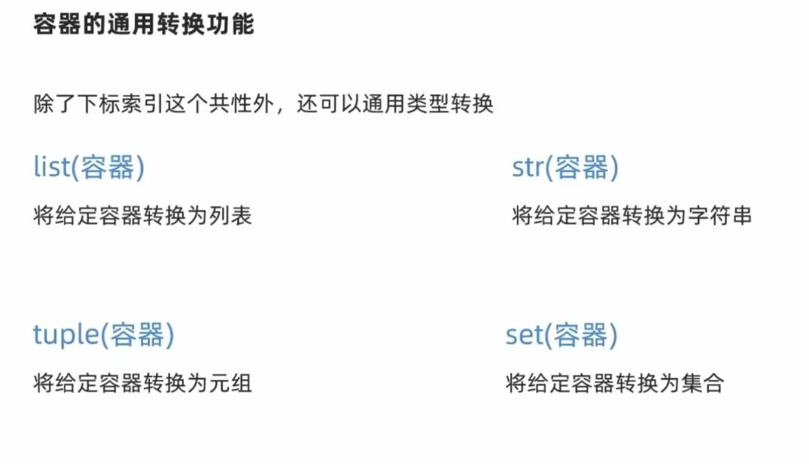
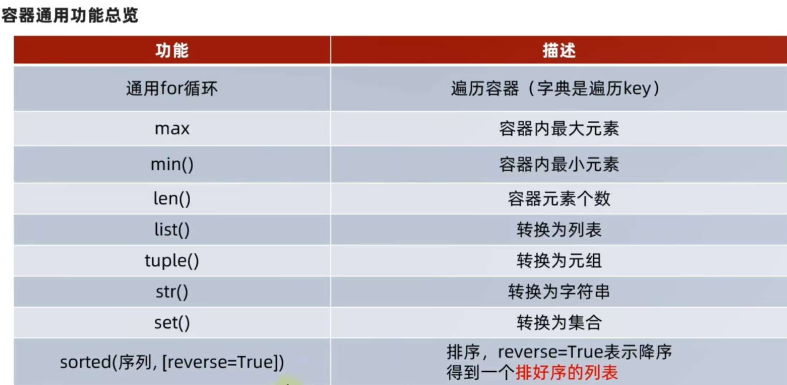

# 数据容器的通用操作：

## 1.循环遍历操作：

尽管数据容器各有特点，但在遍历上，五类数据容器都支持使用for循环进行遍历,但是list/tuple/str支持  
while循环遍历，而set/dict不支持（无法进行下标索引操作）

## 2.统计功能：

len(容器)&nbsp;&nbsp;&nbsp;&nbsp;&nbsp;&nbsp;统计容器的元素个数  
max(容器)&nbsp;&nbsp;&nbsp;&nbsp;&nbsp;&nbsp;统计容器的最大元素  
min(容器)&nbsp;&nbsp;&nbsp;&nbsp;&nbsp;&nbsp;同上，自行理解

## 3.容器的通用转换：

如图所示：

特殊情况：  
字符串与字典转列表或元组或集合时，字符串被按单字符分开，字典仅保留key，丢弃value  
存在dict()函数，但无法将其他数据容器转换为字典

## 4.容器的通用排序功能：

sorted(容器,[reverse = Ture])&nbsp;&nbsp;&nbsp;&nbsp;&nbsp;&nbsp;从大到小进行排序  
sorted(容器,[reverse = False])&nbsp;&nbsp;&nbsp;&nbsp;&nbsp;从小到大进行排序  
注意：排序的结果会统统变成列表对象，reverse默认为False，即默认排序为正向排序（小到大）

# 总结：

## 🧠 知识点总结（复习速查）

> 两天后复习就看这块喵！每个知识点都标注了原码位置，点开对应文件就能回忆喵！

| # | 知识点 | 原码引用 | 要点速记 |
|---|--------|----------|----------|
| 1 | 列表的定义与下标索引 | `List/01_list.py` | 下标从 0 开始，支持正序 `[3]` 和倒序 `[-1]`（-1 取最后一个） |
| 2 | 列表的常用方法 | `List/02_list常用操作.py` | index / insert / append / extend / del / pop / remove / clear / count / len 一套齐全 |
| 3 | 列表的 for/while 遍历 | `List/02_ListCase.py` | for 直接取元素，while 靠下标 `index` 控制，两种都能完成筛选 |
| 4 | 元组的定义与特性 | `Tuple/元组的定义.py` | 内容不可修改，单元素元组必须加逗号 `('x',)`，内部嵌套的 list 却可变 |
| 5 | 字符串的常用方法 | `str/再识str.py` | index / replace / split / strip / count，字符串不可修改（无增删操作） |
| 6 | 字符串比大小 | `str/字符串比大小.py` | 按 ASCII 码逐字符比较，小写 `'a'` 大于大写 `'A'` |
| 7 | 序列切片 | `序列的切片操作/切片操作.py` | 语法 `序列[起始:结束:步长]`，步长为负时倒着取，如 `[::-2]` 取偶数位逆序 |
| 8 | 集合的定义与操作 | `set集合/01_set.py` | 自动去重、无序，add / remove / pop / clear / difference（差集）/ union（合并） |
| 9 | 集合的遍历限制 | `set集合/TraveralSet.py` | 集合无下标索引，while 会报错，只能用 for 遍历 |
| 10 | 字典定义与嵌套取值 | `dict字典/01_dict.py` | 键值对 `key: value`，重复 key 后者覆盖，嵌套用 `字典[key][key]` 逐层取 value |
| 11 | 字典的增删改与遍历 | `dict字典/02_OperateDict.py` | 新增/更新都是 `dict[key] = value`，`pop(key)` 删除并返回 value，`keys()` 拿全部 key |

---

## ⚠️ 注意事项（易踩的坑）

1. ⚠️ 单元素元组忘加逗号：`('hello')` 其实是 **str** 不是元组！必须写 `('hello',)` 喵（见 `Tuple/元组的定义.py`）
2. ⚠️ 元组里的 list 是可以改的：`my_tulpe6[2][0] = "RICHENYV"` 不会报错，别以为元组嵌套就全锁死喵（见 `Tuple/元组的定义.py`）
3. ⚠️ 字典重复 key 不报错，后面的会覆盖前面的：`"SCX": 150` 会被 `'SCX': 98` 悄悄顶掉喵（见 `dict字典/01_dict.py`）
4. ⚠️ set/dict 没有下标索引，用 while 遍历会直接报错（`my_set[下标]` 不可行），只能 for 遍历喵（见 `set集合/TraveralSet.py`）
5. ⚠️ `strip("12")` 不是去掉字符串 `"12"`，而是去掉首尾所有的 `'1'` 和 `'2'` 字符，别想当然喵（见 `str/再识str.py`）
6. ⚠️ 切片步长为负时，起始/结束下标要反过来写，如 `my_list[3:1:-1]` 才是倒着取；写反会得到空列表喵（见 `序列的切片操作/切片操作.py`）