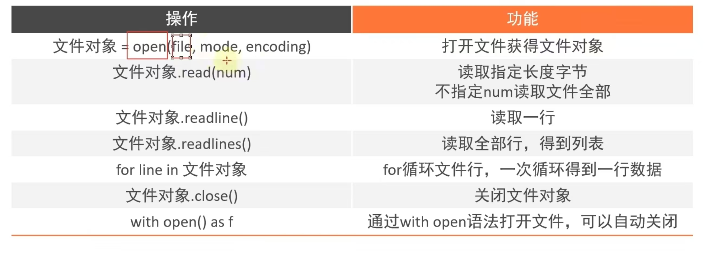

# py的文件操作

## 1.文件编码:

### 编码技术即：翻译的规则，记录了如何将内容转化为二进制

计算机中有很多可用编码，如UTF-8 GBK Big5,其中，***UTF-8是目前全球通用的编码格式***

## 2.什么是文件：

### 文件的操作步骤

***打开、读写、关闭文件***

### open函数：

通过&nbsp;&nbsp; f=open(file,mode,encoding)&nbsp;&nbsp;来在py中打开文件

```python
f = open('D:/python.txt', 'r', encoding="UTF-8")
# f为open函数的文件对象，拥有属性和方法
```

mode常用的三种基础访问方式：

| 模式 | 描述                                                 |
|----|----------------------------------------------------|
| r  | 以只读的方式打开文件                                         |
| w  | 打开文件只用于写入，如果文件已经打开，则从头开始编译，原有内容会被删除，如果文件不存在，创建新的文件 |
| a  | 打开文件用于追加，若文件已经存在，新扽内容将会被写到已有内容中，若无文件，则创建文件         |

### read、readlines方法

文件对象.read(num):  
不输入num默认读取文件全部内容

```python
f = open('D:/python.txt', 'r', encoding="UTF-8")
print(f"输出10个字节：{f.read(10)}")
print(f"输出全部内容：{f.read()}")
# 
```

文件对象.readlines()：  
按照行的方式一次性读取整个文件，并返回一个列表，其中每一行数据为一个元素

```python
f = open('D:/python.txt', 'r', encoding="UTF-8")
lines = f.readlines()
print(type(lines))
print(lines)
# line只读取一行数据
line = f.readline()
print(line)
```

### 文件关闭close:

```python
import time

f = open('D:/python.txt', 'r', encoding="UTF-8")
time.sleep(500000)
f.close()
```

### with open语法：

自动在程序操作完成后关闭文件

```python
with open('D:/python.txt', 'r', encoding="UTF-8") as f:
    for line in f:
        print(line)
```

# 总结：

